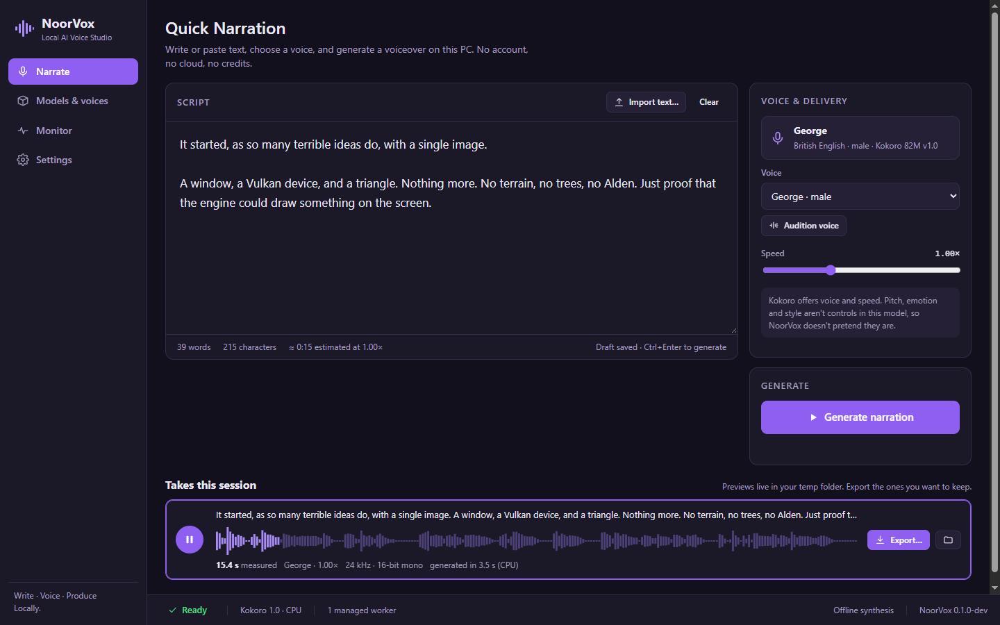

# NoorVox

*Write. Voice. Produce. Locally.* — a Bad Ideas Works project.

NoorVox is a local voiceover studio for Windows: documentary narration, audiobooks, game dialogue, tutorials and quick voiceovers,
generated **offline** with the Kokoro-82M model. It has no accounts, no paid API, and no cloud.

**Status: v0.1.0-dev — Phase 2.** A headless CLI plus NoorVox Studio (WPF + WebView2 + React) with Quick Narration,
model and voice management, and a truthful runtime monitor. Projects and batch production are Phase 3.



See [CHANGELOG.md](CHANGELOG.md) for what exists and what is still planned.

## Quick start (Studio)

```powershell
dotnet build NoorVox.sln -c Release          # also builds the React UI (needs Node.js 20+ with npm)
.\src\NoorVox.Studio\bin\Release\net10.0-windows\win-x64\NoorVoxStudio.exe
```

First run asks where to keep things, then installs the recommended voice with one click. See [docs/USER_GUIDE.md](docs/USER_GUIDE.md).

## Quick start (CLI)

```powershell
dotnet build NoorVox.sln -c Release
$nv = ".\src\NoorVox.Cli\bin\Release\net10.0\win-x64\noorvox.exe"

& $nv storage set --models E:\AI\NoorVox\Models --cache E:\AI\NoorVox\Cache --temp E:\AI\NoorVox\Temp --exports E:\AI\NoorVox\Exports   # optional; C: is fine too
& $nv models install kokoro-82m          # one-time ~390 MB download, verified by sha256 (includes 54 voices)
& $nv synth --text "The first spark of NoorEngine." --voice bm_george --out .\spark.wav
& $nv workers list                       # nothing left running
```

Requirements: Windows 10/11 x64 and the Microsoft Edge WebView2 Runtime (studio); .NET 10 SDK and Node.js/npm to build. No GPU needed: Kokoro runs about 6× faster than real time on CPU.

## Docs

| | |
|---|---|
| [docs/USER_GUIDE.md](docs/USER_GUIDE.md) | Studio walkthrough with screenshots and mockup comparison |
| [docs/CLI_REFERENCE.md](docs/CLI_REFERENCE.md) | Every command, flag, JSON field and exit code |
| [docs/AI_INTEGRATION.md](docs/AI_INTEGRATION.md) | Tested cookbook for Codex and other agents |
| [docs/ARCHITECTURE.md](docs/ARCHITECTURE.md) | Processes, IPC, storage, installer, known limitations |
| [docs/adr/](docs/adr/) | Decisions with measurements |
| [docs/design/](docs/design/) | Original design package, mockup and colour themes |
| [AGENTS.md](AGENTS.md) | Rules for coding assistants |

## Licenses

NoorVox code: TBD by Bad Ideas Works. Kokoro-82M model and voices: Apache-2.0 (hexgrad). KokoroSharp: MIT. MisakiSharp: Apache-2.0.
ONNX Runtime: MIT. React: MIT. WebView2 SDK: Microsoft (BSD-style). NoorVox does not use espeak-ng.
