# NoorVox Studio — user guide (0.3.0)

NoorVox Studio turns text into narration on your own PC. There is no account, cloud or paid credits, and after a one-time model
download it works offline. All screenshots below are of the real application (captured by `tools/studio-smoke.mjs`).

## Installing and starting

Extract `NoorVox-0.2.0-win-x64.zip`, right-click **Install.ps1 → Run with PowerShell**, and answer two questions:
- **Install folder:** any drive; C: is fine.
- **Portable mode:** keeps the settings inside that folder.

You get Start-menu and desktop shortcuts. You can also simply run `NoorVoxStudio.exe` from the extracted folder.
`Uninstall.ps1` in the install folder removes the program and shortcuts, and leaves your models and projects alone.
Only one studio runs at a time.

### First run

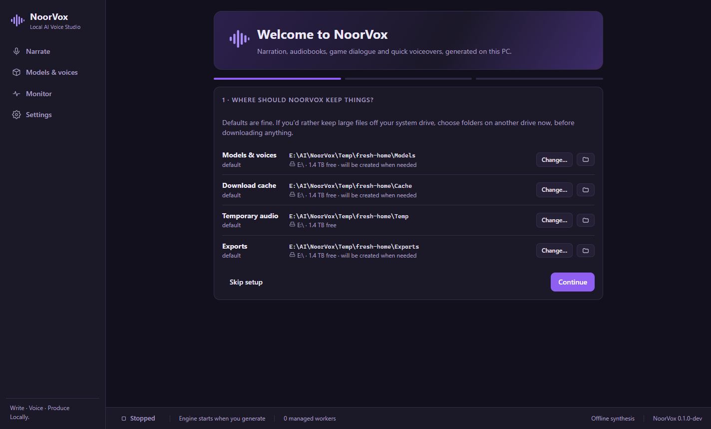

1. **Storage.** Choose where models, the download cache, temporary audio and exports go. The defaults are fine, and C: is fine,
   but if you'd rather keep large files elsewhere, change it *now*, before anything downloads. The exact folder is always shown.
2. **Install a voice.** One click installs Kokoro 82M with 54 voices (about 440 MB). Every file is checked against a known sha256.
3. **Done.** Start narrating. You can skip setup and install a voice later from **Models & voices**.

## Projects

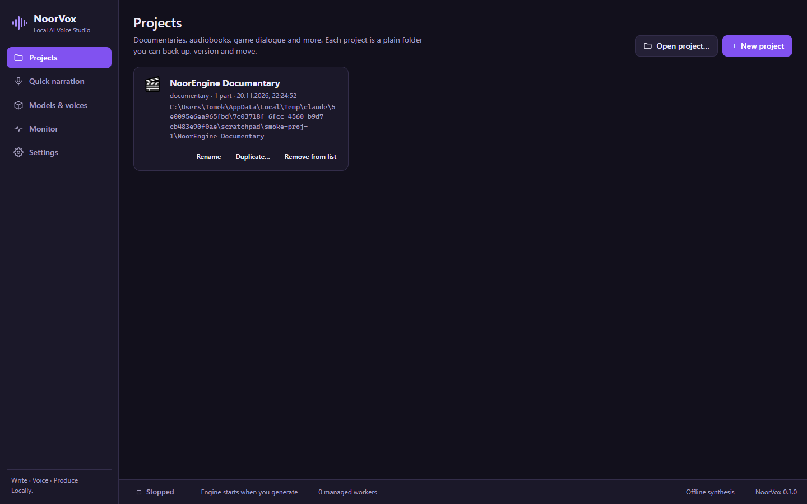

Use a project for anything bigger than a quick line: a documentary episode, an audiobook, or a set of game dialogue.

- **Rename** and **Duplicate…** are on each project card. Duplicate copies the scripts, takes and approvals into a new folder,
  for trying a different cast or edit without touching the original.
- **New project:** give it a name, pick a template (Documentary, Audiobook, Game dialogue, Narration, Education, Custom) and a narrator voice,
  then choose where the folder goes. A project is a normal folder (see `PROJECT_FORMAT.md`), so you can back it up or move it.
- **Import script…:** Markdown or text (`# Episode` / `# Chapter`, `## Scene`, paragraphs become segments; `<!-- notes -->` are kept as
  notes, not spoken), or a dialogue CSV/JSON with `line_id, character, text`. The original file is kept, read-only, in `references/`.

### Working in a project

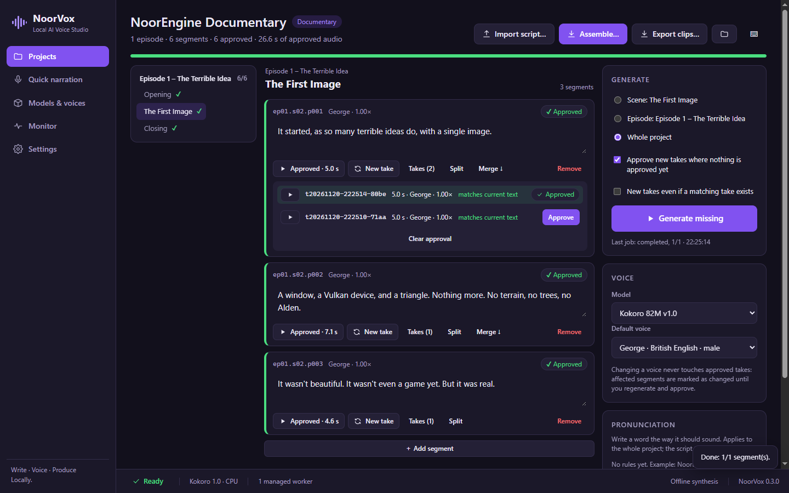

- **Left:** episodes/chapters and their scenes, with approved counts (✔ when a scene is done).
- **Middle:** the segments of the selected scene. Edit text directly; it saves automatically. Each segment shows its stable id, voice,
  and status:
  - ✔ **Approved**
  - ● **Ready to review** (a take exists but isn't approved)
  - ⚠ **Changed since approval** (you edited text or recast the voice; the approved take is kept until you choose)
  - ○ **Not generated**
- **Takes (n)** lists every take of a segment, newest first. Play and compare them, then **Approve** one. **New take** always adds a take;
  it never throws one away, and approvals are never replaced automatically.
- **Right, Generate:** choose the scene, the episode/chapter, or the whole project.
  - *Approve new takes where nothing is approved yet* (on by default) saves clicking through a first pass.
  - *New takes even if a matching take exists* forces fresh takes.
  - While a job runs you see progress and the current segment, with **Stop after this one** and **Stop now**. Every finished segment is saved immediately.
  - A stopped or crashed job shows **Resume**, which continues where it left off.
- **Split / Merge ↓** on a segment: put the text cursor where it should break and press **Split** (Alt+S). The first part keeps its approval
  (marked changed); the second part is new. **Merge ↓** (Alt+M) joins a segment with the next one in the same scene.
- **Keyboard** (⌨ button in the header lists them): Ctrl+Enter new take · Ctrl+Space play · Alt+A approve latest · Alt+S split ·
  Alt+M merge · Alt+PageDown/PageUp next/previous scene.
- **Right, Pronunciation:** type a word as it appears in the script and how it should sound (e.g. *Vulkan → Vull-can*), press **Test** to hear it
  with the project's voice, then **Add rule**. The script text never changes; segments whose speech changes are marked as changed so you know what to regenerate.

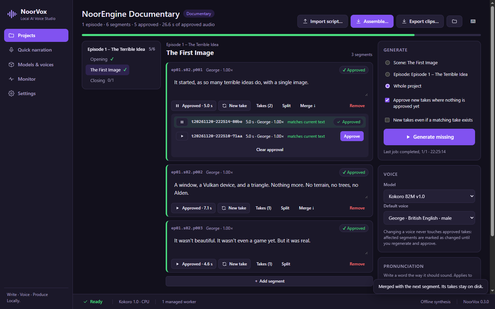

- **Right, Voice / Cast:** the default voice, and for dialogue one voice per character. Recasting marks affected segments as changed.
- **Assemble…** joins the approved takes of the current episode/chapter (or all of them) into one WAV with the project's pauses.
  Choose 48 kHz (video), 44.1 kHz or the native 24 kHz, optional SRT/VTT subtitles and peak normalisation (export only).
  Next to the WAV you get a **timing manifest**: exact start and end of every segment, text, speaker and your `<!-- notes -->`,
  ready for video editing or a video agent. **Open folder** in the bar that appears takes you there.
- **Export clips…** copies the approved takes into a folder you choose, named by id (`npc_vendor_greeting_001.wav`, `001_ep01.s01.p001.wav`),
  plus `clips.json` with durations, text and speakers. Best for game dialogue.

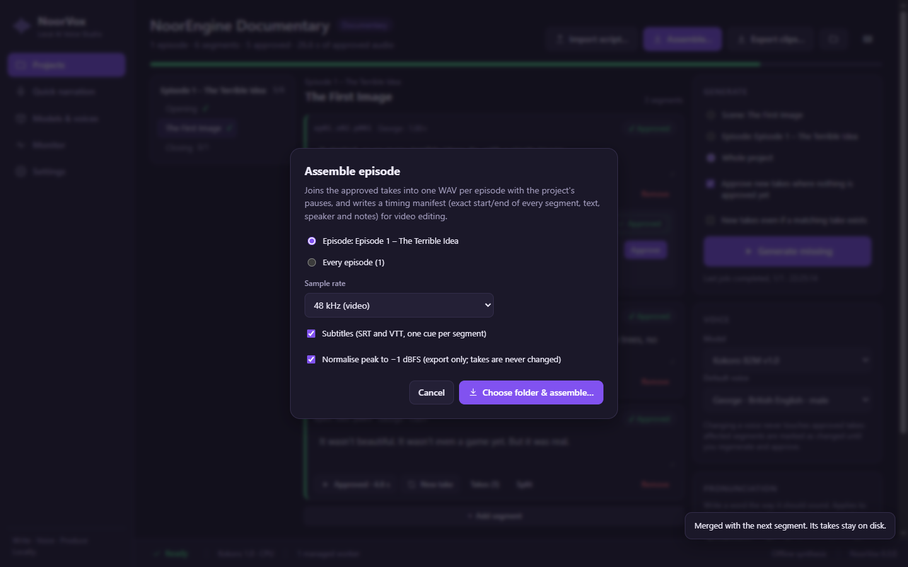

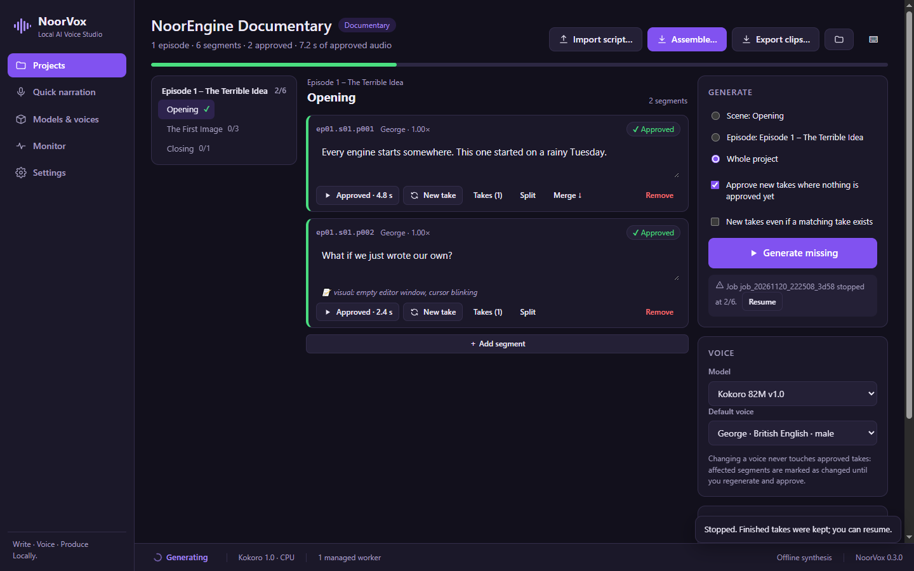

## Quick Narration

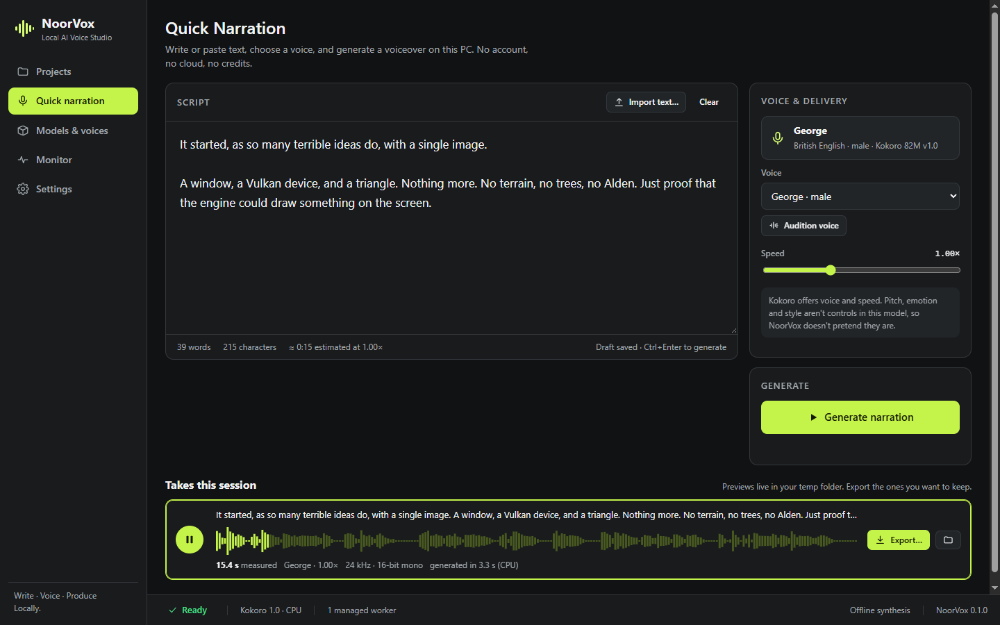

- **Script:** type, paste or **Import text…** (.txt / .md). Your draft is saved automatically.
  The word count and *estimated* duration are only estimates. Real durations always come from the generated audio.
- **Model:** when more than one is installed, choose Kokoro (CPU, fast) or a Qwen3-TTS model (NVIDIA GPU). The controls below change
  to what that model can really do.
- **Voice & delivery:** pick a voice (grouped by language) and use **Audition voice** to hear a short sample.
  - Kokoro: **Speed** runs from 0.5× to 2.0× (double-click resets it to 1.0×). Kokoro has no pitch, emotion or style controls, so NoorVox doesn't show any.
  - Qwen CustomVoice 1.7B: **Style directions** in plain words ("Calm, warm documentary narration with a hint of humour. Speak slowly."),
    a **Language** choice, and **Keep seed**. There's no speed slider: ask for a pace in the style.
  - Every Qwen take shows its **seed**. Click it to reuse it: the same seed, text and settings give exactly the same audio on this PC.
  - Qwen Base: **Clone a voice…** creates a voice from a 5–15 s recording (WAV) and its exact transcript. You must confirm that it's your
    own voice or that you have the speaker's permission; that statement is saved with the voice, and its takes are marked "cloned".
- **Generate narration** (or **Ctrl+Enter**). The first generation starts the voice engine (a few seconds); after that it stays warm.
- **Takes this session:** each generation becomes a take you can play and seek on its waveform. Each shows its *measured* duration, voice,
  speed, format and generation time. Takes survive page switches.
- **Export…** opens a Save dialog in your Exports folder and writes the WAV plus a `.noorvox.json` provenance file
  (text hash, voice, speed, model sha256, timings). The folder button shows the file in Explorer.

Previews are kept in `<Temp>\studio\previews` and removed after 3 days. Export the takes you want to keep.

## Models & voices

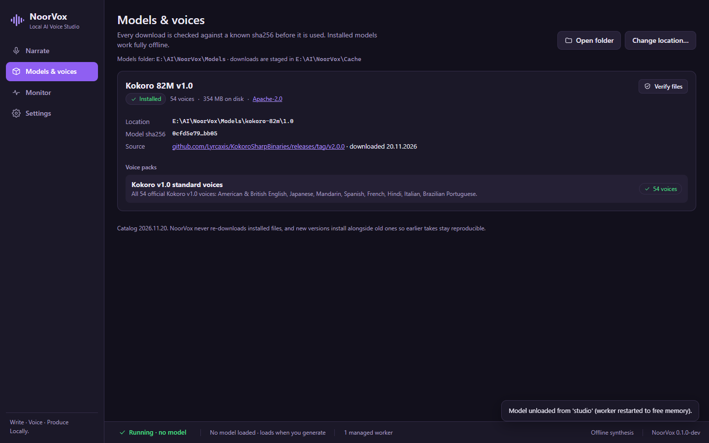

This page shows installed models with their license, source, location, size and sha256, plus their **voice packs**.
**Install** downloads and verifies a model or voice pack, **Update to x.y** appears when a newer version exists (it installs alongside the old one),
and **Verify files** re-hashes everything. **Change location…** moves where *new* installs go; existing files are not moved.

### Qwen3-TTS and engine packs

Qwen models show **NVIDIA GPU**, **style directions**, **voice cloning** and **reproducible** labels. Installing one also installs the
**Qwen3-TTS engine** (a private Python with PyTorch, about 5.2 GB, once for all Qwen models). Every package in it is checked against
a pinned sha256. The **Engine packs** section shows what's installed, what the engine detected (PyTorch, CUDA, your GPU), and resumes an
interrupted install. **ONNX Runtime CUDA provider** is the optional pack that lets Kokoro run on the GPU (Settings → Voice engine).

The first Qwen generation loads about 4.5 GB and prepares the GPU: from an HDD that took 81 s on the development PC. After that, lines
generate about 2.5× faster than real time while the engine stays loaded (it unloads after the idle timeout, or with **Unload** in the Monitor).

### Blended voices

**Models & voices → Blend voices…** mixes 2–4 voices into a new one, for example 60 % George + 40 % Fable for a warmer documentary narrator.
The new voice appears in every voice list (Quick narration, project cast) under the name you gave it. Blends can't be edited afterwards,
because existing takes rely on them, so experiment with new names.

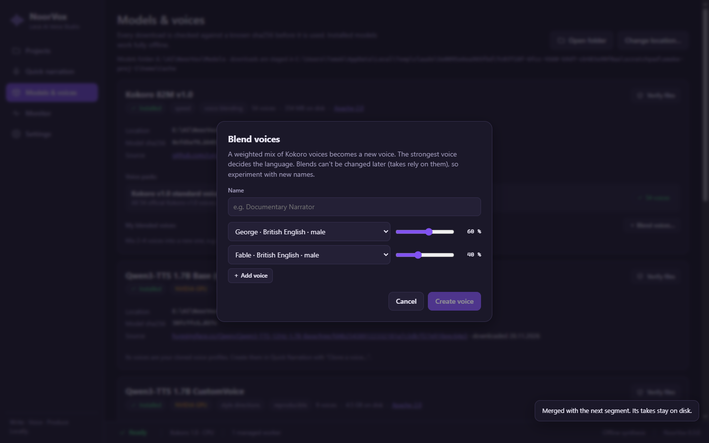

## Monitor

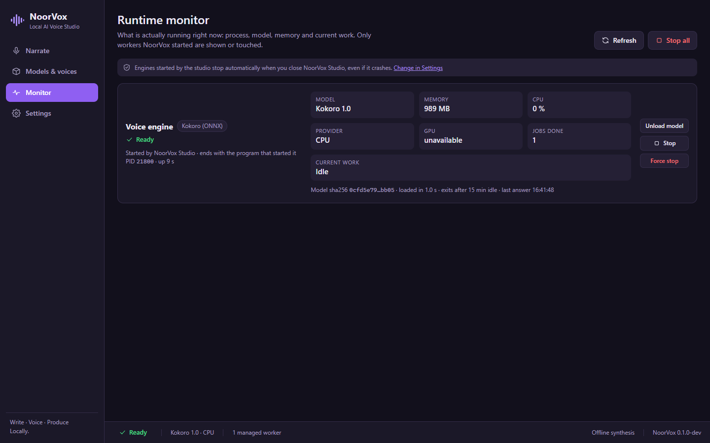

The truthful view of what is running:

- **State** is always shown as an icon plus a word: Stopped · Starting · Running (no model) · Loading model · Ready · Generating · Stopping · Crashed · Not responding.
- PID, uptime, loaded model and its sha256, **memory**, **CPU** (measured between two samples), execution provider, jobs done and current work.
- **GPU memory** (Qwen): what PyTorch has reserved on the card, out of the card's total, with the free amount. It's measured by the engine
  after each load or generation (hover for the time). **Engine memory** is the Python engine's own RAM. Kokoro shows *unavailable* for GPU
  (on CPU there's nothing to show; on CUDA, ONNX Runtime doesn't report it). NoorVox never shows fake zeroes.
- **Provider** is the real one: if you asked for Kokoro on CUDA and it fell back to CPU, the card says CPU and explains why.
- **Unload model** restarts the engine process, which is the only way to really free the model's memory (roughly 1 GB → under 50 MB).
- **Stop** lets the current job finish first. **Force stop** (asks for confirmation) terminates immediately. **Stop all** also stops engines started from the command line.

Only NoorVox-managed workers appear here. NoorVox never touches other programs' processes.

## Settings

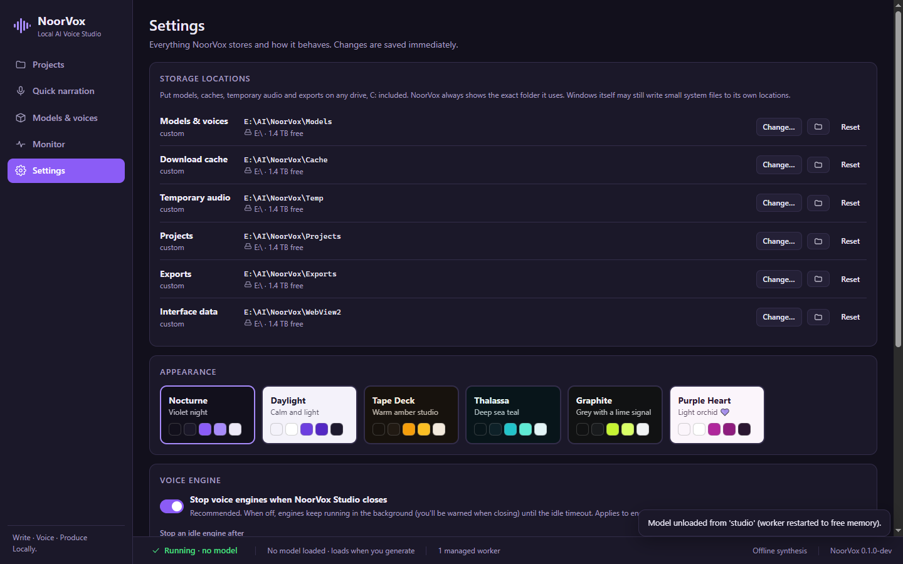

- **Storage locations:** change, open or reset each folder; free space is shown per drive.
- **Appearance:** six themes: Nocturne, Daylight, Tape Deck, Thalassa, Graphite and Purple Heart.
- **Voice engine:**
  - *Stop voice engines when NoorVox Studio closes* (on by default). Even if the studio crashes, Windows ends its engines (Job Object).
    Turn it off to keep a warm engine in the background; you'll be warned when closing.
  - *Stop an idle engine after* 5 min to 1 h, or Never.
  - *Default voice.*

| Themes | |
|---|---|
| 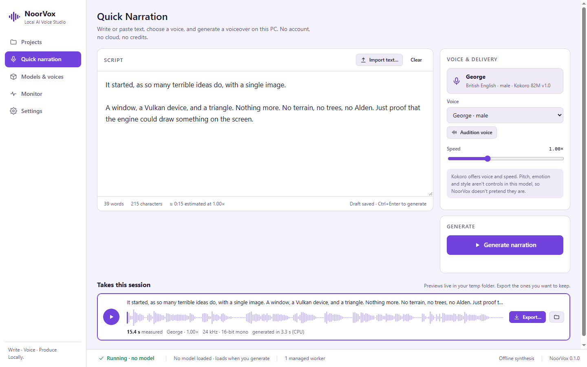 | 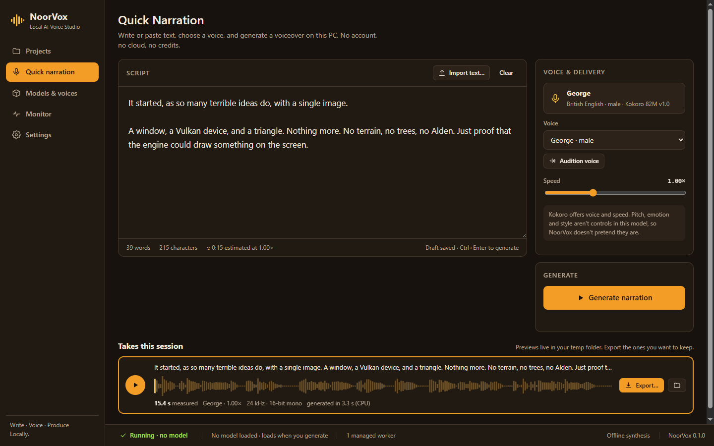 |
| 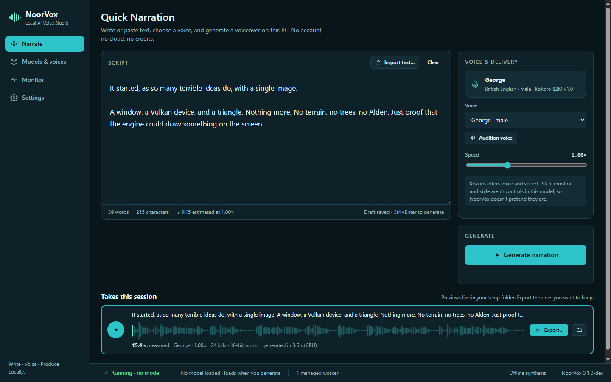 | 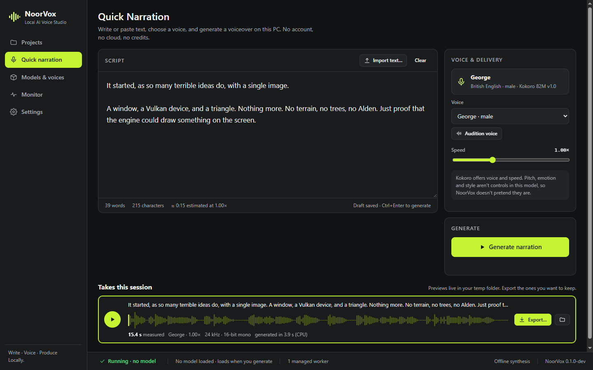 |
| 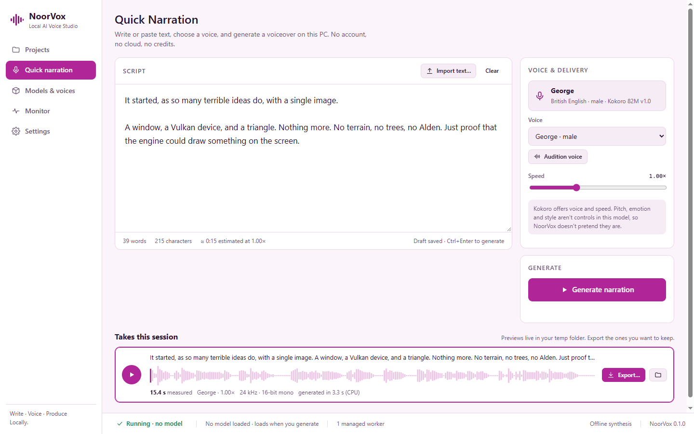 | |

### Storage audit and support bundle

Settings → **Storage audit & diagnostics**:
- **Run storage audit** shows every NoorVox folder with its size and free space. It also warns about NoorVox data in places your settings
  don't use, such as a leftover first run with default paths. It never deletes anything.
- **Create support bundle…** saves a zip for troubleshooting: versions, settings, the audit, installed models and recent logs.
  It never includes your scripts or audio.

## Accessibility

- Every theme meets WCAG AA contrast (4.5:1) for text, muted text, status colours and button text; a test enforces it.
- Worker and segment states always use an icon plus a word, never colour alone.
- Keyboard: Tab through every control; Ctrl+Enter generates in Quick Narration; Enter saves a rename, Escape cancels; Escape closes confirmations.
- "Reduce motion" in Windows turns off spinners and transitions.
- At high scaling the sidebar collapses to icons, which keep their names for screen readers and as tooltips.

## Compared with the concept mockup

The mockup (`design/NoorVox_Interface_Mockup.png`) was treated as guidance, not a target. Where they differ, it's on purpose:

| Mockup | Studio v0.1 | Why |
|---|---|---|
| Pitch, Volume, Style/Tone knobs | Voice + Speed only, with a note explaining why | Kokoro doesn't support the others; no fake controls (spec §11.1) |
| "Kokoro TTS (GPU) · VRAM 2.4 GB", "GPU: RTX 3080" | "Provider CPU · GPU unavailable" | GPU inference doesn't work yet (ADR-0001); the monitor shows what's true |
| "Model Service" / "Embedding (optional)" rows | One row per real worker process | Those processes don't exist |
| Generation progress "72%" | Phase text ("Starting voice engine…", "Synthesizing…") | Kokoro reports no percentage; invented percentages are banned (spec §13.2) |
| Projects / Script / Library / Generate tabs, scene list | Projects (tree, segment editor, takes, generate, cast, assemble, export) · Quick narration · Models & voices · Monitor · Settings | Same hierarchy, built for real; a separate Library view isn't needed yet because exports land in plain folders |
| Documentary / Audiobook / Narration / Dialogue / Education / Custom tabs | The same six templates, chosen when creating a project | A template is a starting point, not a mode you switch |
| Same information hierarchy | Navigation, main workspace, voice panel on the right, takes/player, status bar with engine state | Kept |

## Troubleshooting

- **"Microsoft Edge WebView2 Runtime is required":** install it from Microsoft (it ships with Windows 11 and recent Windows 10).
- **Engine shows Crashed:** press **Clear**, then generate again. The log path is in `<Temp>\logs\worker-studio.log`; the studio log is `<Temp>\logs\studio.log`.
- **Everything from the command line:** `noorvox.exe` offers the same operations headless (docs/CLI_REFERENCE.md).
