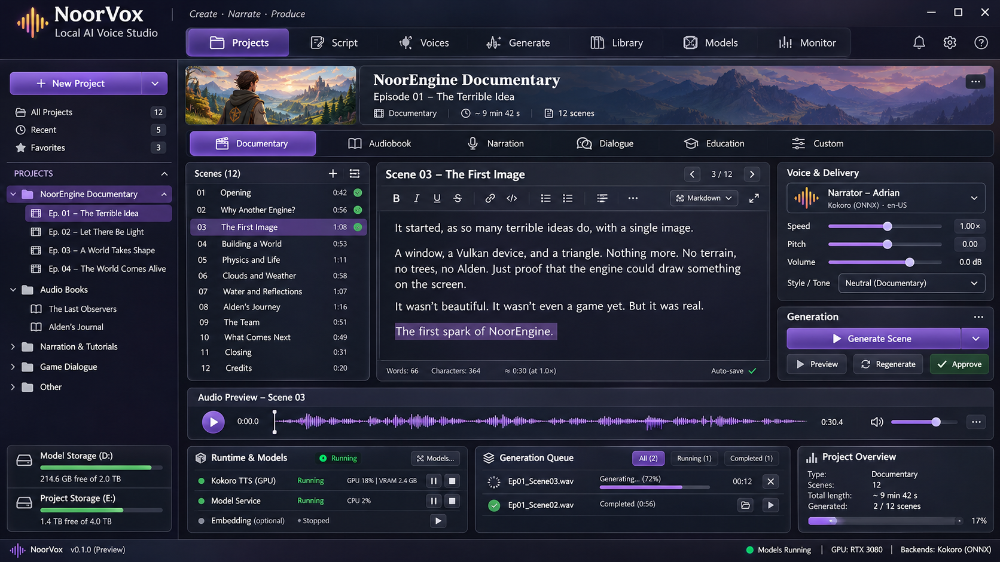

# NoorVox
## Product, UX & Technical Design Specification

**Project:** NoorVox — Local AI Voice Studio  
**Organization:** Bad Ideas Works  
**Document status:** Proposed implementation design (not a claim of existing features)  
**Revision:** 1.0 · 20 November 2026  
**Primary implementation owner:** Sage  
**Downstream automation consumer:** Codex and other AI agents  
**Target platform:** Windows 10/11, x64



> **Product promise:** A friendly desktop voice-production studio for people, with an equally capable, documented headless interface for automation. Create a documentary, audiobook, game conversation, tutorial, or one-off narration locally, without buying API credits, installing a cloud account, or operating a terminal for ordinary work.
>
> **Critical storage correction:** NoorVox does **not** ban installation on `C:`. Users may install and store files wherever they choose. It must be genuinely possible to put the application, model files, model-related caches, projects, exports, and substantial temporary data on non-`C:` drives, with their actual resolved locations visible. Windows and third-party system components may still use OS-managed locations; never claim absolutely zero `C:` writes.

---

## 1. Executive summary

NoorVox is a **standalone, local-first voiceover production application**. It serves two audiences without duplicating business logic:

1. **Human creators** use a comfortable, polished desktop studio to manage projects, write and import scripts, audition voices, generate individual passages, review results, manage models, and export complete recordings.
2. **Automation and AI agents** use a stable CLI and machine-readable project formats to produce narration in batch, track output and timing, inspect running engines, and stop processes cleanly. Codex can subsequently assemble the generated material into videos.

The initial inference backend is a **local Kokoro-family TTS model**, provided that a maintained and correctly licensed ONNX/C# integration proves reliable. The architecture must not be tied to Kokoro. The GUI is built using **C#/.NET + WPF desktop shell + WebView2 + React/TypeScript**; a headless CLI and isolated inference worker(s) use the same underlying core. Speech generation works offline once model dependencies are installed. A separate model manager controls downloads/imports, location, validation, activation, process lifecycle, and resource visibility.

**Out of scope for v1:** a full video editor, music generation, DAW, voice cloning, advanced emotional performance promised irrespective of engine capability, cloud TTS accounts, and a requirement that every model can execute simultaneously.

### 1.1 Success definition

A new user can open NoorVox, select a project template, import or type text, select a voice, preview it, generate a chapter or scene, play it, revise one passage, and export a WAV plus a manifest without opening a terminal. In parallel, an AI can use only documented CLI commands to perform that workflow in a reproducible way. A user can tell exactly **which model is installed, which worker is loaded/running, what it is doing, and how to stop it**.

## 2. User roles and primary jobs

| Role | Primary job | Must be effortless |
|---|---|---|
| Documentary creator | Narrate NoorEngine development episodes from scripts derived from devlogs | Episode/scene management, passage generation, timestamped exports |
| Audiobook producer | Turn a long manuscript into coherent chapter narration | Chapter navigation, batch generation, pause control, consistent voice, resumable sessions |
| Game developer | Produce multiple character dialogue lines for prototypes and final review | Cast/character assignments, line IDs, per-character exports, filename mapping |
| Tutorial / educational creator | Produce lessons or explainers | Section management, pronunciation rules, clean speech and subtitles |
| Casual user | Quickly generate one piece of spoken text | One-screen “Quick Narration” workflow |
| Codex / automation | Generate audio from structured content with no GUI | CLI, deterministic manifests, schema validation, exit codes, model/process status |

Project type is a **workflow template**, not a locked file format. A project can contain narrators, multiple speakers, scenes, chapters, and exports regardless of its initial template.

## 3. Product principles

1. **Human comfort first.** Editing and listening must feel like a creative tool, not a machine-learning research demo.
2. **One engine, two interfaces.** GUI and CLI call the same application services and use the same project schema.
3. **Local by default.** No account or paid API for synthesis. Internet is required only for optional acquisition/update of models or software.
4. **Predictable model lifecycle.** Users can see state and manage it; no hidden persistent GPU worker.
5. **Storage under user control.** Every large storage category can be routed to a chosen drive; never silently change it.
6. **Incremental editing.** A single regenerated paragraph should not invalidate an entire audiobook.
7. **Audio provenance.** Preserve text, voice, model, settings, duration, and generator version for every take.
8. **Honest capabilities.** UI offers only functions actually supported by the selected backend; no decorative pitch/emotion controls that do nothing.
9. **Trustworthy automation.** Jobs can be resumed safely; agents know whether files exist and generation actually succeeded.
10. **Modular, independent distribution.** NoorVox must work without NoorMD, NoorEngine, or Codex.

## 4. Information architecture and navigation

### 4.1 Top-level navigation

- **Projects:** library of local projects, recents, templates, metadata, and batch progress.
- **Script:** editing workspace with project-specific organization.
- **Voices:** installed voices, listening samples, assignments, and pronunciation rules.
- **Generate:** selected segment, scene, chapter, entire project, take management, and queue.
- **Library:** approved takes, generated clips, exports, and source assets.
- **Models:** installed/downloadable model packages, storage, compatibility, versions, and lifecycle actions.
- **Monitor:** active processes, current jobs, GPU/CPU/VRAM/RAM where available, logs, and start/stop controls.
- **Settings:** folders, audio preferences, UI, updates, engine configuration, defaults, and diagnostics.

The concept mockup shows most of these destinations in a single-window dark desktop studio. It is a **visual reference**, not a literal pixel-perfect specification. Sage should preserve the information hierarchy while correcting any illegible small labels and making it fully keyboard-accessible.

### 4.2 Project homepage

Project cards show title, type, last opened, episode/chapter/line count, generation completion, preferred voice, and target export directory. A search bar, Recent, Favorites, and New Project actions are always available. New Project opens a lightweight chooser of **Documentary, Audiobook, Narration, Game Dialogue, Education, Custom**, then asks for name and location, with optional template-specific metadata. Do not force the user through a multi-page setup wizard when defaults suffice.

### 4.3 Common editing layout

**Left:** project/episode/chapter/scene navigation; reorder, duplicate, rename, group, and filter.  
**Center:** script editor; block segmentation; current scene text; word and estimated-duration counts; find/replace; import from Markdown/TXT; autosave.  
**Right:** contextual voice, delivery, pronunciation, generation settings, and take history.  
**Bottom:** dockable transport, waveform, selected audio take, queue progress, and model health.  
**Global status:** storage locations, worker state, backend, warnings, and background jobs.

The main panes are **resizable, collapsible, and persisted per workflow**; users can maximize writing space without hiding essential generation actions. Keyboard shortcuts must cover save, play/pause, generation, undo, find, and switching scenes. A command palette is desirable after core workflows are stable.

## 5. Specialized workflows

### 5.1 Documentary studio

Hierarchy: **Project → Season (optional) → Episode → Scene → Narration segment → Takes**.

- Compose a complete episode script, or import script Markdown written by Codex/Sage.
- Attach source notes and reference files without automatically narrating the notes.
- Assign narrator voices globally or by segment.
- Set segment pauses, pronunciation overrides, and editorial notes separately from spoken text.
- Generate scene previews or batch an episode; approve takes and see missing ones.
- Export voice-only WAV, scene-level WAVs, per-segment clips, SRT/VTT subtitles, and a timing manifest for video assembly.
- Optional cue markers (image, screen recording, chapter title) are metadata for Codex; NoorVox does **not** render video.

**Example:** “The Terrible Idea” episode for NoorEngine, using devlog entries as references and a separate human-approved narration script. Avoid generating factual claims beyond the referenced devlogs without review.

### 5.2 Audiobook studio

Hierarchy: **Book → Part → Chapter → Section/Paragraph → Takes**.

- Import TXT/Markdown first; EPUB/DOCX can be an evaluated extension (not promised before testing extraction and structure).
- Detect headings and paragraph breaks; show and edit proposed chapters before generation.
- Book-wide narrator preset, per-chapter exceptions, optional dialogue speakers.
- Bulk generate by chapter; restart a failed chapter at the first missing/dirty segment.
- Listen across paragraph boundaries so the pacing stays natural.
- Insert chapter-head/chapter-end pauses; preserve chapter markers and metadata.
- Export chapter WAVs, optional long-form audio formats when codecs/licenses permit, and chapter manifests.
- Show estimated storage and processing time **based on locally measured throughput**, not fabricated constants.

### 5.3 Game dialogue studio

Hierarchy: **Game → Dialogue set → Character → Line ID → Takes**.

- Bulk import/export CSV or JSON with stable line IDs, character IDs, and text.
- Cast panel maps each character to a voice and saved pronunciation profile.
- Audition alternate voices; generate only selected lines or an entire dialogue set.
- Batch naming from IDs (`npc_vendor_greeting_001.wav`), not text fragments.
- Include engine-agnostic JSON metadata containing speaker, IDs, duration, and path.
- Avoid automatic emotional variations unsupported by the active TTS backend.
- Future option: export metadata presets for NoorEngine; keep generic formats first.

### 5.4 Quick Narration / Education

Single-screen text box, voice selector, Generate, Preview, and Export. Education adds section segmentation, technical-term pronunciation lists, and subtitle support. Users should be able to produce a short voiceover in a few clicks without creating a full documentary project.

## 6. Script editing, segmentation, and pronunciation

### 6.1 Editing model

- Store original source imports separately from narration text and treat source imports as read-only references by default.
- Support plain text and Markdown; persist structural blocks rather than attempting to infer structure from a giant string at render time.
- A **segment** is the atomic unit for generation, preview, caching, retry, and approval. Its stable ID survives reordering and text edits.
- Allow manual splitting/merging, boundary selection, and paragraph-level regeneration.
- Support text find/replace, per-project autosave and undo/redo, and import/export without hidden format conversion.
- Provide an explicit **spoken text preview** when markdown headings, abbreviations, symbols, or pronunciation replacements affect synthesis.

### 6.2 Duration and pauses

Duration estimates before generation are estimates; actual timings are measured from final audio. Save pauses as structured values in milliseconds, rather than trying to inject undocumented engine tags. Provide defaults for intra-scene, between-scene, and chapter breaks, with overrides.

### 6.3 Pronunciation dictionary

User-editable global, project, and speaker-specific dictionaries; application of precedence must be visible. Support explicit replacements and phonetic notation **only when the backend supports it**. Provide a preview of exactly what will be passed to synthesis. Names like “NoorEngine”, “Vulkan”, “Thalassa”, and “Alden” should be easy to test and override without editing all occurrences.

## 7. Voice and model management

### 7.1 Distinguish four entities

- **Backend:** inference implementation (e.g., Kokoro ONNX/C#); executable/runtime and supported capabilities.
- **Model package:** weights, tokenizer/config, version, license, hash, source, and disk path.
- **Voice:** a speaker style or voice asset compatible with a specific model package.
- **Worker:** a live operating-system process with a PID, selected model(s), loaded resources, and current jobs.

An **installed model is not a running model**; a **running worker** does not necessarily have a model loaded; **loaded** does not mean actively synthesizing.

### 7.2 Model manager screen

For each model: name, backend, source, version, license, download size, installed path, validation result, supported languages/voices, current lifecycle state, compatibility, and controls. Provide actions: **Import, Download, Verify, Load, Unload, Start Worker, Graceful Stop, Force Terminate**. Only show actions valid in the current state; warn before terminating active jobs.

Model downloads must use temporary staging under the selected model/cache location, verify integrity before activation, support cancel/resume where possible, and never silently re-download on startup. A user can work entirely offline with imported models.

### 7.3 Runtime/monitor screen — a first-class feature

The monitor must expose **live, truthful state**, not merely an LED. At minimum:

| Field | Required behavior |
|---|---|
| Worker | Friendly name, backend and PID |
| Status | `stopped`, `starting`, `idle`, `loading`, `ready`, `generating`, `stopping`, `error`, `unresponsive` |
| Model | Installed package and loaded package separately |
| Current work | Project/job/segment, progress if backend reports it |
| Resources | Process RAM and CPU; GPU memory/utilization **only where the platform can provide credible metrics** |
| Health | Last successful heartbeat, uptime, error summary |
| Controls | Start, load, unload, graceful stop, cancel job, force stop (confirmed) |
| Ownership | Whether this is a NoorVox-managed worker or an external/unknown process |

**Do not claim global knowledge of all TTS models on a computer.** The monitor tracks NoorVox-managed workers and their child processes; a diagnostic view may display external related processes only when reliably identified and permission allows.

### 7.4 Start/stop semantics

- **Start Worker:** launch the backend process and await readiness/health handshake. It may be alive with no model loaded.
- **Load Model:** load selected model into that worker; report loading, loaded identity, and measured resource usage.
- **Generate:** queue generation only when a compatible ready model is available; auto-start is configurable and visible.
- **Unload Model:** release the model while keeping a worker ready; verify resource release where the backend supports unloading. If unloading cannot be guaranteed in-process, **restart or terminate the isolated worker** and clearly label the operation.
- **Cancel Job:** cancel current generation safely; partial output is kept separately or deleted according to policy, never reported as approved.
- **Stop Worker:** drain or cancel pending work according to an explicit prompt/policy; request graceful shutdown, wait bounded time, then offer force termination.
- **Force Stop:** require confirmation for active jobs; terminate the tracked process tree; mark interrupted jobs recoverable.
- **Quit Studio:** offer **Stop workers on exit** (default) or **Keep managed workers running** (explicit opt-in). Show a visible warning if background workers will remain.

NoorVox must offer **Stop All Managed Workers** in both the GUI and CLI. The app must not spawn duplicate workers silently. Crashed workers should be detected and marked `error`, not displayed as running.

### 7.5 Process-supervisor implementation

Prefer a separate C# worker host process (or backend-specific subprocess) rather than performing all inference inside the WPF/WebView2 process. This offers meaningful cancellation and cleanup of GPU resources. The supervisor maintains an ownership registry containing PID, creation time, backend, health endpoint/IPC channel, and heartbeat, to avoid attaching to unrelated recycled PIDs. Use OS process handles and Windows Job Objects (where appropriate) to track child processes. Do not terminate external processes simply because their names resemble model workers.

Require an authenticated, local-only IPC channel (named pipes preferred) between supervisor and workers. Do not expose model management to the public network by default. The GUI and CLI can speak to the same local core, using a single-instance broker or other explicit ownership arrangement; avoid two independent supervisors racing to start the same model.

Resource metrics should be labeled with provenance and sampling time. A GPU-specific integration (e.g., NVML on supported NVIDIA systems) may supply VRAM, otherwise say **unavailable** instead of presenting false zeroes.

## 8. Drive paths, storage, portability

### 8.1 User-selected paths

All directories are independently configurable:

| Storage class | Example on user's machine (illustrative only) | Expected behavior |
|---|---|---|
| Application install | `D:\Apps\NoorVox` **or** `C:\Program Files\NoorVox` | Installer allows normal choices |
| Models and voice packs | `D:\AI\NoorVox\Models` | Mandatory destination known before download |
| Model download/cache/staging | `D:\AI\NoorVox\Cache` | Override framework/model caches where feasible |
| Projects | `E:\VoiceProjects` | Select per project or default |
| Rendered takes | `E:\VoiceProjects\...\audio` | Relative paths in portable project structure |
| Final exports | `E:\Exports\NoorVox` | Choice per job/project |
| Transient audio/work | `D:\AI\NoorVox\Temp` | Configurable, quota/cleanup behavior |
| WebView2 user data | User-selected supported path | Set through WebView2 environment options before creation |

**No C-drive prohibition.** A user who wants default Windows locations may use them. A user avoiding C: should be able to configure the significant application data before model setup. Do not pretend the OS, logs of other software, Windows runtime or system-level dependencies will never touch C:.

### 8.2 Storage setup and observability

At first launch show a **Storage Setup** page with drive selector, existing folder browser, estimated storage and an editable **Advanced paths** panel. Provide **Move Storage** and **Reveal Folder** functions, free space, size, and a **Storage Audit**: configured path, resolved path, bytes used, unexpected model-related writes found by diagnostic logging where possible. Refuse a download only when space, permissions, validation, or explicit user policy makes it unsafe, **not because the path is on C:**. Honor custom paths for third-party backends via documented configuration/environment variables **before backend startup**.

### 8.3 Portability

Projects should prefer relative asset paths beneath the project root. Absolute external sources are identified clearly and can be **packaged for transfer**. Paths saved in project files should be portable; on moving a project, offer to locate missing sources without invalidating approved takes. Do not embed multi-gigabyte model weights into ordinary project archives.

## 9. Technical architecture

### 9.1 Proposed technology stack

- **Desktop shell:** WPF on supported .NET LTS, Windows-only.
- **Desktop web surface:** Microsoft Edge **WebView2**, with explicitly chosen user-data directory.
- **Frontend:** React, TypeScript, Vite (or equivalent stable bundling tool), local bundled assets; no production-time CDN requirement.
- **Application core:** C# services for project store, script parsing, validation, queue, caching, media metadata, and output assembly.
- **Worker supervision:** C# host/manager with explicit process handles, IPC and lifecycle state machine.
- **Initial TTS implementation:** investigate a Kokoro ONNX C# binding such as KokoroSharp; verify current maintenance, licenses, language/voice coverage, ONNX Runtime compatibility, packaging, and measured CPU/CUDA performance before committing.
- **Future backends:** adapters implementing an explicit `ITtsBackend` contract. A Python subprocess may be used only if a specific, justified backend requires it, while keeping the core application in C#.
- **Media tools:** in-process WAV handling, waveform derivation; optional FFmpeg for concatenation/transcoding where compatible with licensing and distribution.
- **CLI:** separate `noorvox.exe` / `noorvox-cli.exe` headless entry point sharing core services, without launching WebView2.

### 9.2 Logical components

```text
                       ┌─────────────────────────┐
                       │   NoorVox Desktop       │
                       │ WPF + WebView2 + React  │
                       └───────────┬─────────────┘
                                   │ typed bridge
                       ┌───────────▼─────────────┐
 noorvox-cli ──────────►│ NoorVox application core│
                       │ projects / jobs / audio │
                       └────┬─────────┬──────────┘
                            │         │
                 ┌──────────▼──┐  ┌───▼─────────────────┐
                 │ Project store│  │ Worker supervisor  │
                 │ JSON + media │  │ health + lifecycle │
                 └──────────────┘  └───┬─────────────────┘
                                       │ private local IPC
                          ┌────────────▼────────────┐
                          │ Local inference worker  │
                          │ Kokoro ONNX / adapters  │
                          └─────────────────────────┘
```

Both CLI and GUI should use one consistent **local application broker** when concurrently active; define clear locking and ownership. Worker isolation is a requirement, not an optional phase-two cleanup, because the user explicitly wants reliable process control.

### 9.3 C# contracts (conceptual)

```csharp
public interface ITtsBackend
{
    string BackendId { get; }
    TtsCapabilities Capabilities { get; }
    Task<IReadOnlyList<VoiceInfo>> ListVoicesAsync(CancellationToken ct);
    Task<ModelHandle> LoadAsync(ModelRef model, CancellationToken ct);
    Task<GeneratedAudio> SynthesizeAsync(
        ModelHandle model, SegmentRequest request, CancellationToken ct);
    Task UnloadAsync(ModelHandle model, CancellationToken ct);
}

public interface IWorkerSupervisor
{
    Task<WorkerStatus> GetStatusAsync(string workerId, CancellationToken ct);
    Task<WorkerStatus> StartAsync(string workerId, CancellationToken ct);
    Task StopAsync(string workerId, StopPolicy policy, CancellationToken ct);
    Task ForceStopAsync(string workerId, CancellationToken ct);
}
```

The interface is provisional: do not copy it blindly if real backend limitations make it impossible. `UnloadAsync` may be implemented via worker recycle when backend runtime memory cannot safely be released otherwise.

### 9.4 WebView2 communication/security

Use a typed request/response/event bridge (JSON messages with request IDs), validate every input at the C# boundary, and limit exposed operations to documented commands. Bundle the web UI locally, disable unexpected remote navigation, avoid `eval`-like dynamic code paths, escape imported Markdown/HTML to prevent XSS, and never let untrusted script text become a filesystem path or shell command. Do not expose unrestricted process execution to the JavaScript layer. Keep sensitive model management and disk I/O in C#.

### 9.5 Offline behavior

On normal launch with installed assets, generation, preview, project editing, and exports work without Internet. A model manager may optionally check for updates; make these checks opt-in/configurable and show any download size and destination. No telemetry required to generate audio; any future telemetry must be opt-in.

## 10. Project file and data model

A project should be a directory rather than one opaque database file. SQLite is acceptable for **derived indexes/cache**, but the authoritative project and script files should remain readable, documented, and versioned.

**Suggested layout:**

```text
NoorEngine_Documentary/
  noorvox.project.json
  scripts/
    episode_01.json
    episode_02.json
  references/
    source_index.json
  voices/
    pronunciation.json
  takes/
    ep01_scene03_segment04_take02.wav
  exports/
    ep01_narration.wav
    ep01_narration.srt
    ep01_manifest.json
  .noorvox/
    cache_index.json
    jobs.json
```

Proposed project fields: `schemaVersion`, `projectId`, `title`, `kind`, `createdAt`, `modifiedAt`, `defaultVoice`, `enginePreferences`, `sections`, `sourceRefs`, `exportProfiles`. Segment fields: `segmentId`, `text`, `speakerId`, `voiceId`, `pronunciationProfile`, `pauseBeforeMs`, `pauseAfterMs`, `editorialNotes`, `takeIds`, `approvedTakeId`. Generated take fields: `takeId`, `segmentId`, `modelId`, `modelHash`, `backendVersion`, `voiceId`, `effectiveSettings`, `textHash`, `sourceTextSnapshot`, `filePath`, `durationMs`, `sampleRate`, `createdAt`, `approvalStatus`. Store full generation settings so exports remain auditable.

### 10.1 Cache identity

Hash at least: normalized effective spoken text, segmentation rules, pronunciation dictionary version, backend ID/version, model hash, voice identity, generation settings, relevant random seed if supported, and audio-processing settings. Text edits mark the affected segment dirty, not adjacent approved segments, unless a context-dependent backend requires regeneration across boundaries. Never replace an approved take automatically; produce a new take and allow comparison.

### 10.2 Job durability

Jobs are persisted before execution, with state `queued`, `preparing`, `running`, `completed`, `cancelled`, `failed`, `interrupted`. A job result is complete only when the file exists, passes basic validation, and metadata is committed. On restart, unfinished jobs become recoverable. Save partial output to temporary filenames and atomically move validated files into place. Never silently delete successful takes when a later segment fails.

## 11. Generation and audio pipeline

```text
Source material → editable project script → segment validation
    → voice/model resolution → worker ready → synthesis into temp WAV
    → audio validation → optional processing → immutable take
    → user approval or automated policy → assembly + subtitles
    → final audio + timing/provenance manifest
```

### 11.1 Synthesis controls

Only expose available, backed controls: voice, speaking rate, text splitting, supported languages, and supported model-specific parameters. If pitch, emotion, or style is not controllable by Kokoro or the selected backend, **hide/disable the control and explain why**. The mockup includes stylistic example knobs; implementation must be truthful. Offer a sample phrase for voice audition and an A/B take comparison.

### 11.2 Audio conventions

WAV is the required baseline. Preserve native model output sample rate internally; resample with a tested algorithm to requested export rate (e.g., 48 kHz for documentary). Measure durations from final audio samples. Preserve per-segment source timestamps, optional silence intervals, and assembly offsets. Make loudness normalization and peak limiting **optional and non-destructive**, so approved source takes are never overwritten. MP3 and other codecs are optional depending on available tooling/license constraints.

### 11.3 Captions and manifests

Export SRT/VTT segment-level captions and JSON timing manifests. Segment-level timing is trustworthy; **word-level alignment is optional**, and must not be fabricated from estimated word durations. If precise forced alignment is later added, report the alignment engine and confidence. A video agent should receive one manifest pointing to final audio and all segments, with actual start/end times and text.

## 12. CLI and AI automation contract

The CLI must have a stable, versioned contract and operate **without GUI startup, WebView2, or interactive dialogs** when `--non-interactive` is set. The following verbs are **proposed targets, not commands that already exist**; Sage should implement, document, and test the final syntax.

```powershell
noorvox --version
noorvox doctor --json
noorvox storage show --json
noorvox models list --json
noorvox voices list --model kokoro-82m --json
noorvox workers list --json
noorvox workers start --backend kokoro --json
noorvox workers load --worker kokoro-default --model kokoro-82m --json
noorvox workers stop --worker kokoro-default --graceful --json
noorvox workers stop --all --graceful --json
noorvox projects validate --project "E:\VoiceProjects\NoorEngine" --json
noorvox generate segment --project "E:\VoiceProjects\NoorEngine" --segment ep01.s03.p04 --json
noorvox generate episode --project "E:\VoiceProjects\NoorEngine" --episode ep01 --non-interactive --json
noorvox jobs status --job job_123 --json
noorvox export episode --project "E:\VoiceProjects\NoorEngine" --episode ep01 --format wav --manifest --subtitles --json
```

Do not hardcode model IDs or program directories into commands beyond portable examples. Use a typed schema rather than screen scraping. Every command should support `--help`; consider `--config`, `--json`, and `--non-interactive` where appropriate.

### 12.1 Output and exit codes

- JSON includes `schemaVersion`, `success`, stable `code`, user-readable `message`, request/job IDs, and machine-readable `data`.
- Regular progress events go to stderr or a dedicated event stream; stdout stays valid JSON when `--json` is used.
- Errors use nonzero exit codes and distinguish configuration, missing model, invalid script, busy worker, cancelled task, synthesis failure, export failure, and permission failure.
- Longer commands can return a job ID and optionally `--wait` for completion.
- Cancellations should leave recoverable state; no command reports success merely because work started.
- All returned paths must be actual resolved file paths; callers must not guess where output landed.
- Multi-instance or resource contention must return a clear error or queue according to explicit policy.

### 12.2 AI-agent integration guide (deliverable required of Sage)

Implement and maintain `AI_INTEGRATION.md` with a tested end-to-end procedure:

1. Run `doctor` and inspect available storage, backends, models, and voices.
2. Validate project schema and incoming script; reject unsupported settings.
3. Check worker state; start/load only if necessary.
4. Generate preview segment; verify file, duration, and synthesis settings.
5. Submit remaining scenes/chapters, observe job status, retry recoverable failures.
6. Export narration and a timing manifest; verify every referenced path exists.
7. Stop/unload workers according to the user’s requested lifecycle policy.
8. Pass the manifest to a video editor agent without reinterpreting the narration text.

Provide runnable PowerShell and generic JSON-based examples. Include failure-handling examples and explicit notes that this tool **does not write the documentary story itself**; another agent may prepare and approve the script. Generate machine-readable `--help`/schema documentation alongside prose if practical.

## 13. User experience details

### 13.1 First-run experience

Three short steps, skippable where defaults are safe:

1. **Welcome / choice of workflow:** Quick Narration or Project Studio.
2. **Storage:** show app location, model/cache, project, exports, and temp; each editable; offer sensible defaults, but make non-C installation/storage easy.
3. **Voice setup:** discover compatible local engines and imported models, or guide a verified install to the chosen directory. Include a short sample preview.

A user who has no model installed should still be able to open the UI, edit scripts, and inspect projects; Generate is disabled with a clear action to install/import a model.

### 13.2 Job progress

For a chapter or episode, show: total segments, done/queued/current/failed, actual file outputs, remaining count, and optional *measured* approximate duration. Provide pause after current segment, stop, cancel, retry failed, and view logs. Avoid claiming percentage for TTS operations that cannot provide progress; use phase/status rather than invented percentages.

### 13.3 Error handling

Errors tell the user what failed, which file/path/worker was involved, what survived, and the next available action. Never discard a manually edited script because a model worker crashes. Surface unsupported voices, drive unplugging, out-of-space errors, and CUDA failures with graceful fallback or guidance. Error details can be copied or saved in a support bundle without exposing unrelated private scripts by default.

### 13.4 Accessibility and UI quality

Windows-native keyboard navigation and focus behavior; scalable text; minimum contrast; tooltips and labeled icons; screen-reader semantics in the web UI; high-DPI support; reasonable responsiveness under active GPU load. Long scripts should virtualize the visible list and avoid regenerating waveforms on every keystroke. Support both dark and light themes (mockup represents the dark theme). Never rely solely on color to indicate worker state or approvals.

## 14. Reliability, privacy, and security

- Everything is local by default; no automatic script uploads or paid voice-service calls.
- Validate model provenance, known hashes and package integrity; display license and source before installation.
- Avoid insecure model file types or arbitrary executable downloads when possible; keep dependencies pinned and audit update mechanisms.
- Treat imported scripts and Markdown as untrusted data; sanitize rendered content, normalize paths, and restrict file writes to user-selected destinations.
- Local IPC is not publicly network-accessible and requires correct client/worker identity.
- Protect project data through atomic writes, versioned schemas, backup copies for migration, and recovery of interrupted renders.
- Model worker processes should be terminable without killing the editor or corrupting a project.
- Do not auto-run user-supplied plugins or code on project open.
- Publish a clear compatibility and licensing notice, particularly when bundling ONNX Runtime providers, codecs, fonts, models or voice packs.

## 15. Measurable acceptance criteria

### 15.1 Functional acceptance

- [ ] Create/open/rename/duplicate a project using the GUI; project reopens after restart.
- [ ] Complete Quick Narration with no terminal and a valid WAV.
- [ ] Documentary template: episode/scene navigation, voice assignment, preview, export plus timing manifest.
- [ ] Audiobook template: import manuscript, edit chapters, batch process, resume after interruption, export chapter WAVs.
- [ ] Dialogue template: import lines with stable IDs, assign characters/voices, produce correctly named per-line WAVs.
- [ ] Edit one segment and regenerate it without replacing unrelated approved takes.
- [ ] CLI performs equivalent operations headlessly and emits parseable JSON.
- [ ] Exported manifest refers to existing audio and accurately measured durations.

### 15.2 Model and process acceptance

- [ ] Installed / loaded / generating / stopped statuses are accurately distinguished.
- [ ] Start Worker, Load Model, Unload Model, Stop Worker, Stop All and Force Stop behave as documented.
- [ ] Active job cancellation does not corrupt the project or mark incomplete takes as approved.
- [ ] A crashed worker becomes `error`/`unresponsive`, and the app remains usable.
- [ ] Closing NoorVox follows an explicit, user-visible background-worker policy; no surprise workers left consuming VRAM under the default policy.
- [ ] Two CLI/GUI clients cannot accidentally start duplicate ownership of the same worker.
- [ ] RAM/CPU reporting works; GPU stats are truthful or explicitly unavailable.

### 15.3 Storage acceptance

- [ ] Installation on C: is **allowed**.
- [ ] Installation/storage on a non-C: drive is supported.
- [ ] A test configuration puts all major model assets, model-related caches, project data, temp audio and exports on selected non-C: paths.
- [ ] Model downloads show resolved destination and do not silently put model weights under the Windows profile.
- [ ] Storage Audit reveals configured and resolved paths, including WebView2 user data.
- [ ] The application remains functional offline after model provisioning.

### 15.4 Quality acceptance

- [ ] Reasonable high-DPI behavior at 100%, 150%, 200% scaling.
- [ ] No UI freeze during model load, long generation, or a slow disk operation.
- [ ] Keyboard navigation, autosave, take comparison, and progress controls pass scripted UI smoke tests.
- [ ] A generated audio clip is audible, non-empty, valid PCM WAV, and sample count matches reported duration.
- [ ] Documentation examples run successfully in CI or repeatable local tests.

## 16. Implementation phases (vertical slices)

| Phase | Deliverable | Gate before advancing |
|---|---|---|
| **0 — Research/decisions** | Validate KokoroSharp or equivalent, model/voice licenses, ONNX CPU/CUDA providers, storage behavior, worker isolation, WebView2 packaging | A short ADR with real local test results and a tiny WAV |
| **1 — Core vertical slice** | C# core, process worker, local model import, storage settings, one voice, CLI generate, WAV export | One command synthesizes offline, stores files at chosen paths, worker stops cleanly |
| **2 — Studio shell** | WPF+WebView2+React, project browser, Quick Narration, script editor, preview, model/runtime monitor | User generates and exports without terminal; Start/Stop and status work |
| **3 — Production workflows** | Documentary, audiobook, dialogue presets, bulk generation, takes, approvals, project persistence | End-to-end sample for each template; safe interruption/recovery |
| **4 — Automation contracts** | Versioned CLI, full manifest, subtitle export, thorough AI docs and examples | Codex-style agent generates an episode headlessly from source script |
| **5 — Polish and delivery** | Accessibility, performance, installer/portable option, diagnostics, storage audits, docs, smoke tests | Acceptance criteria met; honest release notes and known limitations |

Do not build every speculative control before audio works. Preserve the app’s clean architecture and polished UX throughout, rather than delivering a nonfunctional visual prototype.

## 17. Required documentation and repository structure

Expected documentation deliverables (Sage may improve filenames but should preserve roles):

```text
README.md                 # Why NoorVox exists, install, quick start
DESIGN.md                 # This spec, updated when architectural decisions change
ARCHITECTURE.md           # Real modules, process model, IPC, dependencies
USER_GUIDE.md             # Human workflows with screenshots
CLI_REFERENCE.md          # Exact commands, flags, output, exit codes
AI_INTEGRATION.md         # Tested cookbook for Codex and other agents
PROJECT_FORMAT.md         # Versioned project, script and manifest schemas
MODEL_BACKENDS.md         # Backend capabilities, licenses, paths and troubleshooting
STORAGE_AND_PRIVACY.md    # Cache paths, setup, offline behavior, audit
CHANGELOG.md              # Implemented vs planned features
examples/                 # Quick narration, audiobook, dialogue, documentary
```

A separate minimal **`AGENTS.md`** in the repo root should tell coding assistants where the authoritative CLI/schema docs live, how to invoke tests, how to avoid destructive model management, and how to maintain documentation when an interface changes. It must not replace the full `AI_INTEGRATION.md`.

## 18. Risks, constraints, and open decisions

| Issue | Risk / mitigation |
|---|---|
| Kokoro naturalness on long-form prose | Audition real chapters; paragraph chunking, pauses, pronunciation; do not promise human-level emotion |
| C# ONNX voice/model integration | Validate exact model and voice compatibility, provider packages and output quality in phase 0 |
| “Unload” might not return all GPU memory | Use worker process isolation and teardown, verify on actual GPU |
| WebView2 runtime/system files | Keep WebView2 user-data path configurable; explain OS-managed components and no absolute C: guarantee |
| Long scripts can generate thousands of assets | Incremental hashing, job journal, quotas, disk space checks and search |
| Silence and duration mismatches | Measure output samples, test actual merges, never estimate final timing |
| AI CLI automation can accidentally overwrite takes | Stable IDs, dry-run/validate, immutable approved takes and explicit replace policy |
| Licensing | Verify model/voice/codecs distribution and commercial-use terms before shipping model bundles |
| Multiple applications control one worker | Single local broker, authenticated IPC and ownership registry |
| CLI contract churn | Semantic versioning for schemas, compatibility tests, migration notes |

**Decisions to resolve by measured prototype, not by assumption:** exact Kokoro adapter; whether GPU provider packages are ship-safe and functional on target machines; details of background worker persistence across UI exit; best audio assembly library and codecs; project store indexing strategy; and whether a later external service mode is useful. None of these blocks a well-defined phase-one vertical slice.

## 19. Guidance for Sage: how to begin

1. Read this spec and inspect the mockup; restate constraints faithfully, especially that **C: is allowed but optional** and that **monitoring and clean shutdown are core features**.
2. Research the current compatible Kokoro/C# implementations and licenses rather than treating named libraries as guaranteed.
3. Create a short ADR deciding the worker/process model, first model format, and storage initialization.
4. Make a real offline WAV using the C# core and a model stored in a selected non-C: directory. Measure GPU/CPU behavior rather than guessing.
5. Add worker lifecycle commands and a status probe before building a complex interface.
6. Build the desktop shell and Quick Narration workflow with genuinely functional preview/generate/stop controls.
7. Develop the multi-workflow project system and batch/manifest pipeline iteratively.
8. Document the exact CLI/API **as implemented** and verify it with sample automation.
9. Keep explicit tests and a visible list of unimplemented features; never present mockup-only elements as working.

## 20. Definition of done

NoorVox v1 is done when it is pleasant to use for a person writing and listening to long-form audio, straightforward for an AI agent generating a batch without a GUI, safe for project data, honest about model state and resource use, and configurable enough that a user can operate it with **models and all significant project data on other drives**. The NoorEngine documentary pipeline should then be able to consume its voiceover and timing manifest without a paid speech account.

---

**Visual reference:** `NoorVox_Interface_Mockup.png` (concept artwork; not a screenshot of a working application).  
**Working name:** NoorVox.  
**Design motto:** *Write. Voice. Produce. Locally.*
